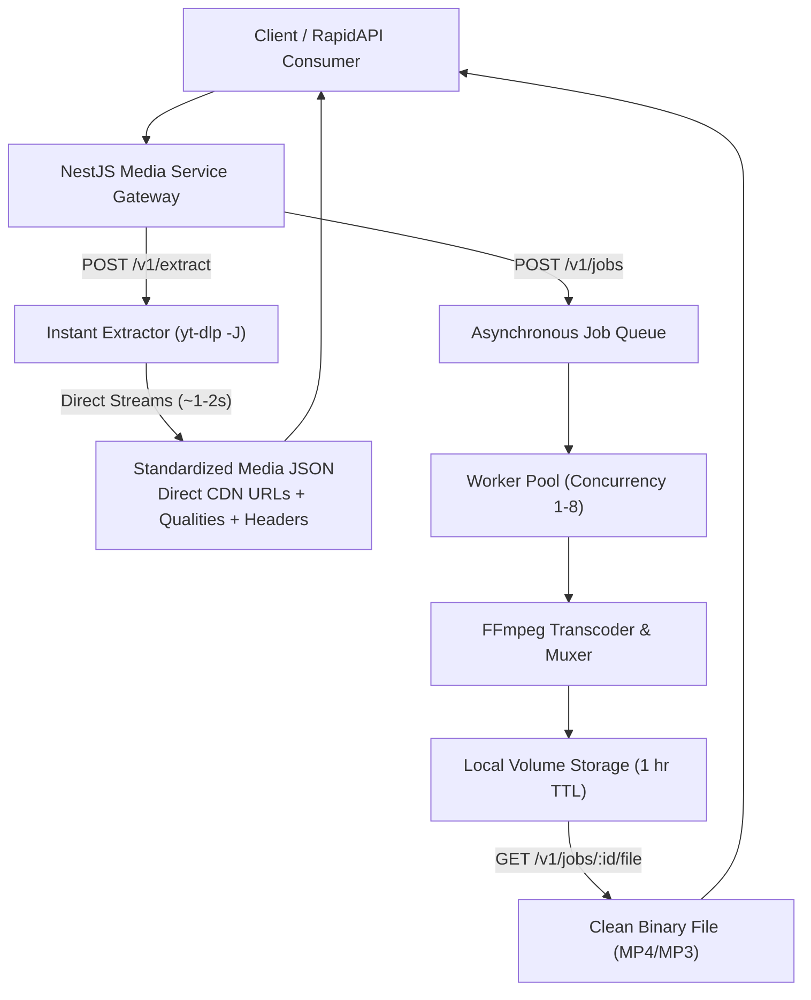

# YTDownloader — NestJS Media Extraction & Transcoding API

A high-performance, production-ready media processing microservice built with **NestJS 11**, **TypeScript**, and **yt-dlp + FFmpeg**.

Engineered for commercial deployment on **RapidAPI**, **Railway**, and **Docker**, featuring interactive Swagger documentation, multi-tenant consumer isolation, automated cleanup, and dual extraction/transcoding pipelines.

---

## Architecture Overview

The API provides two operational modes to satisfy both real-time apps and high-fidelity video downloaders:



### Mode 1: Instant Extraction (`POST /v1/extract`)
* **Speed**: ~1–2 seconds.
* **Storage**: **0 MB server disk used**. Direct stream URLs are returned straight from the media provider's CDN.
* **Use Cases**: Video player apps, live streaming players, client-side downloaders, metadata scrapers.
* **Returns**: Standardized metadata, creator info, thumbnail, duration, direct video/audio URLs, full format lists (144p to 4K), audio bitrates, and required HTTP headers/cookies.

### Mode 2: Server-Side Transcoding & Download (`POST /v1/jobs`)
* **Speed**: Background asynchronous queue with real-time status polling.
* **Output**: Clean `.mp4` (up to 4K) or `.mp3` (up to 320 kbps) files hosted directly on your server.
* **Use Cases**: End-user browser downloads, platforms with strict CDN hotlinking protections (e.g. TikTok Akamai 403), merging separate video + audio tracks into a single portable file.
* **Lifecycle**: Queued → Processing → Completed (stored for 1 hour) → Automatically deleted.

---

## Supported Media Platforms (10 Providers)

| Platform | Supported Content | Mode 1: Extract (`/v1/extract`) | Mode 2: Jobs (`/v1/jobs`) | Example URL |
| :--- | :--- | :---: | :---: | :--- |
| **YouTube** | Videos, Shorts, Music | Direct CDN URLs | MP4 (144p–4K), MP3 | `https://www.youtube.com/watch?v=BaW_jenozKc` |
| **TikTok** | Full videos, Original audio | Direct CDN URLs + Headers | Clean MP4, MP3 | `https://www.tiktok.com/@creator/video/1234567890` |
| **Instagram** | Reels, Video posts | Direct CDN URLs | Clean MP4, MP3 | `https://www.instagram.com/reel/EXAMPLE123/` |
| **Facebook** | Watch, Reels, Video posts | Direct CDN URLs | Clean MP4, MP3 | `https://www.facebook.com/watch/?v=1234567890` |
| **X / Twitter** | Video posts, Amplify media | Direct MP4 / HLS | Clean MP4, MP3 | `https://x.com/creator/status/1234567890` |
| **Snapchat** | Spotlight videos, Stories | Direct Bolt CDN MP4 | Clean MP4, MP3 | `https://www.snapchat.com/@creator/spotlight/1234567890` |
| **Twitch** | Live streams, VODs, Clips | Live HLS `.m3u8`, VODs | VODs & Clips to MP4/MP3 | `https://www.twitch.tv/videos/1234567890` |
| **Vimeo** | Public single videos | Direct CDN URLs | MP4 (144p–4K), MP3 | `https://vimeo.com/76979871` |
| **Dailymotion** | Public videos, dai.ly | Direct CDN URLs | MP4 (144p–1080p), MP3 | `https://www.dailymotion.com/video/x84sh87` |
| **SoundCloud** | Public individual tracks | Direct Audio Streams | MP3 (128k–320k) | `https://soundcloud.com/artist/track` |

> **Live Platform Source of Truth**: Query `GET /v1/platforms` at runtime for real-time accepted domains and URL schemas.

---

## Platform Details & Known CDN Behaviors

### 1. TikTok (`tiktok.com`)
* **Audio Track**: Hosted on ByteDance public nginx clusters (`v58.tiktokcdn.com`). Downloads freely in any browser without authentication.
* **Video Streams**: Hosted on Akamai EdgeSuite (`v16-webapp-prime.tiktok.com`). Direct browser clicks from external origins return `403 Forbidden: Access Denied` due to Akamai anti-hotlinking.
  * **Browser Download**: Use `POST /v1/jobs` to let the server transcode and deliver a clean, unblockable file.
  * **API Consumers**: Use `httpHeaders` and `cookies` returned in `POST /v1/extract` to fetch video streams programmatically.

### 2. Snapchat (`snapchat.com`)
* **Spotlight & Stories**: Public spotlight videos (`/@user/spotlight/:id` or `/spotlight/:id`) and stories (`/p/:id`, `t.snapchat.com/:id`).
* **Direct Delivery**: Videos are hosted on Google Cloud Storage CDN (`bolt-gcdn.sc-cdn.net`) with `Access-Control-Allow-Origin: *`. Raw `.mp4` URLs stream and download cleanly in any browser.

### 3. Twitch (`twitch.tv`)
* **Live Streams (`https://www.twitch.tv/channel`)**: Fully supported for **`POST /v1/extract`**. Returns the live HLS master playlist (`.m3u8`) and multi-bitrate options (1080p60 source, 720p60, 480p, audio only). Marked with `isLive: true` and `durationFormatted: "LIVE"`.
* **Server Jobs**: Live streams are blocked from `POST /v1/jobs` to prevent unbounded recording. Completed VODs (`/videos/:id`) and Clips are fully downloadable to MP4/MP3 files.

### 4. X / Twitter (`x.com`, `twitter.com`)
* **Direct MP4 Priority**: Extracts progressive `.mp4` video files (`/vid/avc1/...mp4`) whenever available, with automated fallback to adaptive HLS (`.m3u8`).
* **Audio Isolation**: Properly distinguishes AAC audio streams (`/pl/mp4a/...`) from video streams so `bestVideo` always links to playable video.

---

## Upcoming Platforms (Not Applied Yet / Backlog)

The following platforms are planned for upcoming releases:

| Provider | Target Content | Status | Planned Features |
| :--- | :--- | :---: | :--- |
| **Reddit** | `reddit.com/r/.../comments/...` | Backlog | Multiplex separate `v.redd.it` video and audio streams |
| **Pinterest** | `pinterest.com/pin/...`, `pin.it/...` | Backlog | Video Pins and story extraction |
| **Threads** | `threads.net/@user/post/...` | Backlog | Video posts and carousels |
| **Bilibili** | `bilibili.com/video/...`, `b23.tv/...` | Backlog | Public videos and FLV/DASH streams |
| **LinkedIn** | `linkedin.com/posts/...` | Backlog | Video updates and shared articles |
| **Bluesky** | `bsky.app/profile/.../post/...` | Backlog | Embedded video player feeds |
| **Kick** | `kick.com/video/...` | Backlog | VODs, clips, and live channel playlists |

---

## How to Configure & Add a New Platform Provider

Adding a new platform provider takes **under 10 lines of code** in [`src/media/platforms.ts`](src/media/platforms.ts).

### Step 1: Add the Rule to `PLATFORM_RULES`
In `src/media/platforms.ts`, add your new provider object:

```typescript
{
  id: 'reddit',
  name: 'Reddit',
  hosts: ['reddit.com', 'www.reddit.com', 'v.redd.it'],
  formats: ['mp4', 'mp3'],
  example: 'https://www.reddit.com/r/videos/comments/EXAMPLE123/sample_post/',
  notes: 'Public posts containing native Reddit video (v.redd.it).',
  canonical: url => {
    // Return sanitized canonical URL, or undefined if unsupported
    const match = /^\/r\/[\w-]+\/comments\/[\w-]+(?:\/[\w-]+)?\/?$/.exec(url.pathname);
    return match ? `https://www.reddit.com${match[0].replace(/\/+$/, '')}` : undefined;
  },
},
```

### Step 2: (Optional) Define Job Restrictions
If the platform has un-recordable media (like live broadcasts):
In `normalizeMedia()` in `src/media/platforms.ts`:
```typescript
if (platform === 'reddit' && isLiveContent(canonical)) {
  throw new BadRequestException('Live streams cannot be processed as server jobs. Use POST /v1/extract.');
}
```

### Step 3: Export OpenAPI & Verify Tests
Run the automated test suite to verify routing and schema consistency:
```powershell
npm run openapi:export
npm test
```
The new platform is now instantly live, discoverable in `GET /v1/platforms`, documented in Swagger UI, and supported by both `/v1/extract` and `/v1/jobs`!

---

## Environment Variables & Configuration

Set these variables in your deployment environment or in a `service/.env` file:

| Variable | Required | Default | Description |
| :--- | :---: | :---: | :--- |
| `API_KEY` | Optional* | — | Direct operator bearer key (min 32 chars). For private access. |
| `RAPIDAPI_PROXY_SECRET` | Optional* | — | Secret header sent by RapidAPI Gateway proxy (min 32 chars). |
| `PUBLIC_API_URL` | No | Origin | Public HTTPS URL (used in OpenAPI spec & Swagger `servers`). |
| `DATA_DIR` | No | `./data` | Local directory for storing downloaded files & queue state. |
| `PORT` | No | `3000` | HTTP listening port. |
| `HOST` | No | `0.0.0.0` | Binding interface (`0.0.0.0` in Docker/Railway). |
| `WORKER_CONCURRENCY` | No | `2` | Parallel download/transcode workers (integer 1–8). |
| `FILE_TTL_MS` | No | `3600000` | Retention period before completed files are deleted (1 hour). |
| `JOB_TIMEOUT_MS` | No | `900000` | Processing timeout before aborting yt-dlp/ffmpeg (15 min). |
| `MAX_DURATION_SECONDS` | No | `600` | Maximum media duration allowed for download jobs (10 min). |
| `MAX_FILESIZE` | No | `200M` | Maximum media filesize allowed by yt-dlp. |
| `YTDLP_PATH` | No | Auto | Custom path to `yt-dlp` executable. |
| `FFMPEG_PATH` | No | Auto | Custom path to `ffmpeg` executable. |
| `FFPROBE_PATH` | No | Auto | Custom path to `ffprobe` executable. |

*\*At least one of `API_KEY` or `RAPIDAPI_PROXY_SECRET` must be set.*

---

## API Endpoints Reference

### 1. Instant Link Extraction
**`POST /v1/extract`**
```json
// Request
{
  "url": "https://www.youtube.com/watch?v=BaW_jenozKc"
}

// Response (HTTP 200)
{
  "id": "BaW_jenozKc",
  "platform": "youtube",
  "title": "Sample Video Title",
  "description": "Video description...",
  "thumbnail": "https://i.ytimg.com/vi/.../maxresdefault.jpg",
  "duration": 19,
  "durationFormatted": "00:19",
  "author": {
    "name": "Creator Name",
    "username": "@creator",
    "url": "https://www.youtube.com/@creator"
  },
  "isLive": false,
  "download": {
    "video": "https://rr---.googlevideo.com/videoplayback?...",
    "audio": "https://rr---.googlevideo.com/videoplayback?..."
  },
  "medias": [
    {
      "formatId": "137",
      "type": "video",
      "quality": "1080p",
      "resolution": "1920x1080",
      "ext": "mp4",
      "height": 1080,
      "width": 1920,
      "fps": 30,
      "filesize": 15482900,
      "filesizeFormatted": "14.8 MB",
      "hasVideo": true,
      "hasAudio": false,
      "url": "https://...",
      "httpHeaders": {
        "User-Agent": "Mozilla/5.0 ...",
        "Referer": "https://www.youtube.com/"
      }
    }
  ]
}
```

### 2. Create Asynchronous Transcode Job
**`POST /v1/jobs`**
```json
// Request
{
  "url": "https://www.youtube.com/watch?v=BaW_jenozKc",
  "format": "mp4",          // "mp4" | "mp3"
  "quality": 1080,          // 144, 240, 360, 480, 720, 1080, 1440, 2160
  "audioQuality": "320k"    // "128k", "192k", "256k", "320k" (ignored for mp4)
}

// Response (HTTP 202 Accepted)
{
  "id": "3fa85f64-5717-4562-b3fc-2c963f66afa6",
  "status": "queued",
  "format": "mp4",
  "platform": "youtube",
  "createdAt": "2026-10-22T12:00:00.000Z",
  "expiresAt": null
}
```

### 3. Check Job Status
**`GET /v1/jobs/{id}`**
```json
// Response (HTTP 200)
{
  "id": "3fa85f64-5717-4562-b3fc-2c963f66afa6",
  "status": "completed",    // "queued" | "processing" | "completed" | "failed" | "cancelled"
  "format": "mp4",
  "platform": "youtube",
  "size": 15482900,
  "downloadPath": "/v1/jobs/3fa85f64-5717-4562-b3fc-2c963f66afa6/file",
  "createdAt": "2026-10-22T12:00:00.000Z",
  "expiresAt": "2026-10-22T13:00:00.000Z"
}
```

### 4. Download Completed File
**`GET /v1/jobs/{id}/file`**
* **Headers Required**: `Authorization: Bearer <API_KEY>` or RapidAPI Gateway headers.
* **Response**: Binary stream (`video/mp4` or `audio/mpeg`) with `Content-Disposition: attachment; filename="media.mp4"`.

### 5. Smart Extraction with Job Fallback
**`POST /v1/fallback`**
* Automatically attempts instant direct extraction first (~1–2s).
* If direct extraction is restricted (e.g. TikTok video streams on Akamai CDN) or fails, seamlessly falls back to creating an asynchronous server transcode job.
* Returns `{ "mode": "extract" | "job", ... }`.

### 6. Utility Endpoints
* `GET /v1/fallback`: Information and capabilities of the fallback controller pipeline.
* `GET /v1/platforms`: Returns all 10 enabled platforms and rules.
* `GET /v1/jobs`: Returns the 100 most recent jobs for the calling user.
* `DELETE /v1/jobs/{id}`: Cancels a queued or running job.
* `GET /health`: Liveness probe.
* `GET /health/ready`: Media tools (`yt-dlp`, `ffmpeg`, `ffprobe`) & disk space readiness.
* `GET /docs`: Interactive Swagger UI.
* `GET /openapi.json`: OpenAPI 3.0 specification.

---

## Deployment Guides

### Deploy to Railway (Recommended)
1. Fork or push this repository to GitHub.
2. In [Railway.app](https://railway.app/), click **New Project** → **Deploy from GitHub repo**.
3. Railway automatically detects [`railway.toml`](../railway.toml) and builds using [`service/Dockerfile`](Dockerfile).
4. Add Environment Variables in Railway's dashboard:
   * `API_KEY`: Generate a random 32+ character hex string.
   * `RAPIDAPI_PROXY_SECRET`: (If selling on RapidAPI) Copy from your RapidAPI dashboard.
   * `PUBLIC_API_URL`: Your Railway domain (e.g. `https://ytdownloader-production.up.railway.app`).
5. Deployment is live with automatic SSL and zero server maintenance!

### Deploy with Docker Compose
```bash
# 1. Set environment
export API_KEY=$(node -e "console.log(require('crypto').randomBytes(32).toString('hex'))")

# 2. Build and launch
docker compose -f service/compose.yaml up --build -d
```
The Docker container runs securely as non-root user `node`, with a read-only root filesystem, Linux capabilities dropped, and a dedicated volume mounted at `/app/data`.

### Sell on RapidAPI
1. **Deploy your service** to Railway or a public server with HTTPS.
2. **Copy the OpenAPI spec**: Copy the contents of `service/openapi.json` or point RapidAPI to `https://your-domain/openapi.json`.
3. In the **RapidAPI Provider Dashboard**:
   * Set **Target URL** to `https://your-domain`.
   * Under **Security & Threat Protection**, copy the **Proxy Secret**.
   * Set `RAPIDAPI_PROXY_SECRET=<proxy_secret>` in your server environment variables.
   * In your RapidAPI endpoint settings, disable the imported `direct-key` requirement (RapidAPI handles consumer authentication with `x-rapidapi-key`).
4. RapidAPI consumers are automatically isolated: each customer only sees and accesses their own jobs and download files!

---

## Local Development & Testing

### 1. Requirements
* Node.js **20+** or **22+**
* FFmpeg & yt-dlp installed on PATH, OR use the built-in Windows tool installer:

### 2. Windows Tool Installer
From the repository root, install local verified binaries into `service/tools`:
```powershell
npm --prefix service run tools:install
```

### 3. Start Local Dev Server
```powershell
# Set temporary local secret
$env:API_KEY = "test-secret-key-must-contain-at-least-32-characters"

# Start NestJS development server
npm --prefix service run start:dev
```
Open [http://localhost:3000](http://localhost:3000) for the developer web UI or [http://localhost:3000/docs](http://localhost:3000/docs) for Swagger UI.

### 4. Run Test Suite
```powershell
npm --prefix service test
```
Runs all 12 unit and integration test suites against isolated mock runners and real NestJS HTTP modules.
